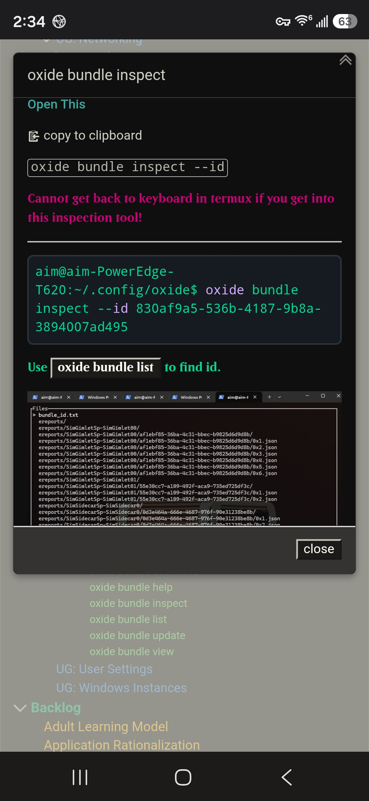
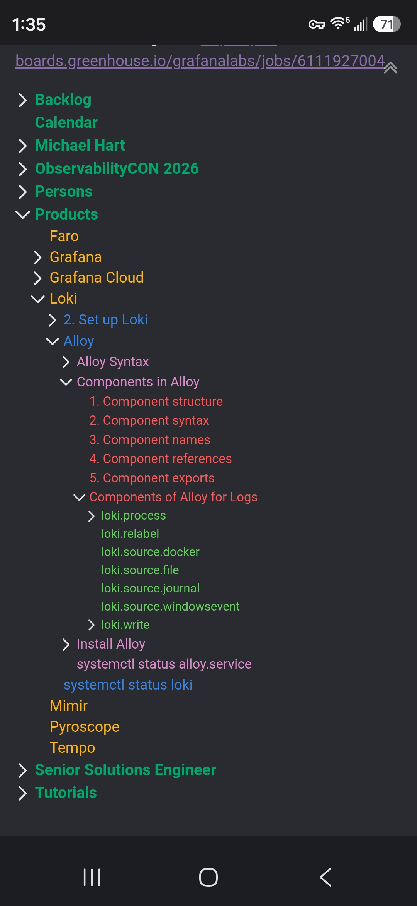

# ThrownOxide
My Wiki to do all things if I worked at Oxide Computer

| | |
|:---:|:---:|
|  |  |

# ThrownOxide

An unofficial, community-written wiki on working with [Oxide Computer Company](https://oxide.computer) systems: the Oxide rack, its control plane, and the tooling around it.

> **Disclaimer:** This project is not affiliated with, endorsed by, or sponsored by Oxide Computer Company. "Oxide" and related names are trademarks of their respective owners. Everything here is based on public documentation and personal research. Verify against official docs before relying on it in production.

## What's in here

This wiki collects practical how-tos, notes, and walkthroughs for Oxide infrastructure that I didn't want to see go to waste.

## How to use this wiki

1. Clone the repo:
   ```bash
   git clone https://github.com/ThrownWolfCon/ThrownOxide.git
   cd ThrownOxide
   ```

## Official resources

- Oxide website: https://oxide.computer
- Oxide documentation: https://docs.oxide.computer
- Oxide on GitHub: https://github.com/oxidecomputer

## Contributing

Corrections and additions are welcome.

1. Fork the repo
2. Create a branch (`git checkout -b fix/topic-name`)
3. Commit your changes
4. Open a pull request

Please keep content accurate, cite sources where possible, and don't include anything confidential or covered by an NDA.

## License

See [LICENSE](LICENSE).
